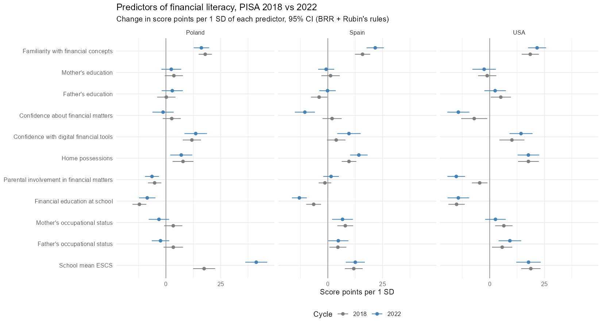

# Predictors of Adolescent Financial Literacy: PISA 2018 vs. 2022

R code for analyzing which student, family and school factors predict 15-year-olds' financial literacy in the **United States, Poland and Spain**, and whether those relations changed between the pre-pandemic (2018) and post-pandemic (2022) PISA cycles.

Based on my M.S. thesis at Purdue University (December 2025).

## Key findings

- **Consistent positive predictors** in almost every country and cycle:
  - Familiarity with financial concepts
  - Confidence with digital financial tools
  - Home possessions
  - School socioeconomic composition
- **School-based financial education was negatively associated** with financial literacy in every model. Exposure alone is a weak indicator of effective financial socialization.
- General financial confidence and family financial involvement were negatively associated in several models.
- **Few predictors changed between 2018 and 2022.** The clearest shift is the growing association of school socioeconomic composition in Poland.
- Models explain **13–34%** of the variance in financial literacy, and more in 2022 than in 2018 in all three countries.

This repository fits a separate model for each country and cycle. The formal tests of change between cycles (pooled models with cycle × predictor interactions) are reported in the accompanying manuscript.



## Results

### Variance explained

| Country | 2018 R² | 2022 R² |
|---|---|---|
| USA | 0.235 (0.228–0.242) | 0.246 (0.233–0.260) |
| Poland | 0.216 (0.194–0.228) | 0.338 (0.326–0.348) |
| Spain | 0.134 (0.127–0.143) | 0.206 (0.196–0.217) |

Mean over the 10 plausible values, with the range in parentheses.

<details>
<summary><b>Unstandardized coefficients</b> (score points; click to open)</summary>

| Predictor | USA 2018 | Poland 2018 | Spain 2018 | USA 2022 | Poland 2022 | Spain 2022 |
|---|---|---|---|---|---|---|
| Gender: Male | 6.72* | 2.82 | -0.62 | 6.07 | 7.95* | 0.77 |
| Immigrant background: Second-generation | 14.65** | -9.66 | -15.09* | 15.17* | 4.99 | 8.53 |
| Immigrant background: First-generation | -14.25 | -95.46*** | -6.91 | -4.99 | -46.63 | -20.74** |
| Familiarity with financial concepts | 3.76*** | 3.27*** | 3.09*** | 4.69*** | 3.12*** | 4.61*** |
| Mother's education | -0.77 | 2.89 | 0.67 | -1.67 | 1.89 | -0.42 |
| Father's education | 3.28* | 0.14 | -2.06* | 1.59 | 2.26 | -0.07 |
| Confidence about financial matters | -6.82* | 2.67 | 1.90 | -15.03*** | -1.26 | -10.34*** |
| Confidence with digital financial tools | 10.14*** | 12.37*** | 3.77 | 14.94*** | 13.01*** | 9.43*** |
| Home possessions | 15.13*** | 10.03** | 11.16*** | 19.18*** | 8.78** | 16.51*** |
| Parental involvement in financial matters | -4.32* | -5.38*** | -1.31 | -12.37*** | -5.42*** | 1.31 |
| Financial education at school | -13.96*** | -12.60*** | -6.46*** | -12.33*** | -8.18*** | -12.26*** |
| Mother's occupational status | 0.29** | 0.15 | 0.34*** | 0.12 | -0.14 | 0.27** |
| Father's occupational status | 0.25* | 0.17 | 0.21* | 0.40*** | -0.12 | 0.20* |
| School mean ESCS | 34.62*** | 38.97*** | 21.00*** | 34.36*** | 79.30*** | 24.49*** |

\* p < .05, \*\* p < .01, \*\*\* p < .001. Reference groups: female, native students. First-generation estimates for Poland rest on very few students and are unstable.

</details>

Diagnostic plots for each country and cycle are in [`plots/`](plots/), and test results are in [`output/diagnostics.csv`](output/diagnostics.csv).

## Methods

| Challenge | How it is handled |
|---|---|
| Outcome measured with error | 10 plausible values; one model per PV, pooled with **Rubin's rules** (`mitools::MIcombine`) |
| Complex survey sample | Final student weights plus **Fay's BRR** variance estimation with 80 replicate weights (ρ = 0.5) (`survey::svrepdesign`) |
| Missing predictors | **Multiple imputation** with `mice` (m = 10; PMM for continuous predictors, logistic or polytomous regression for categorical ones); imputation *k* is paired with PV *k* |
| Changed coding across cycles | 2022 parental education (ISCED 2011) harmonized to the 2018 scale |
| School context | School socioeconomic composition = weighted school mean of student ESCS |
| Model assumptions | Residual plots, VIF and Breusch–Pagan test per country × cycle (`output/diagnostics.csv`) |

An option `IMPUTE_WITH_OUTCOME` (default `FALSE`, as in the thesis) runs a sensitivity analysis in which the outcome is included in the imputation model.

## Repository structure

```
R/analysis.R      full pipeline: import → cleaning → descriptives → imputation → models → tables/plots
data/             PISA .SAV files go here (not tracked)
output/           CSV results and results_table.md (created by the script)
plots/            coefficient plot and diagnostic plots (created by the script)
```

## Reproducing

1. Download the PISA 2018 and 2022 financial literacy student files (SPSS) from https://www.oecd.org/pisa/data/ and place them in `data/`:
   - `CY07_MSU_FLT_QQQ.SAV` (2018)
   - `CY08MSP_FLT_QQQ.SAV` (2022)
2. Install the packages:
   ```r
   install.packages(c("tidyverse", "haven", "mice", "survey", "mitools", "car", "lmtest"))
   ```
3. From the repository root, run:
   ```
   Rscript R/analysis.R
   ```

## Citation

Gorgulu, R. (2025). *Money matters: How predictors of adolescent financial literacy have changed over time across countries* [Master's thesis, Purdue University].

## License

MIT, see `LICENSE`.
